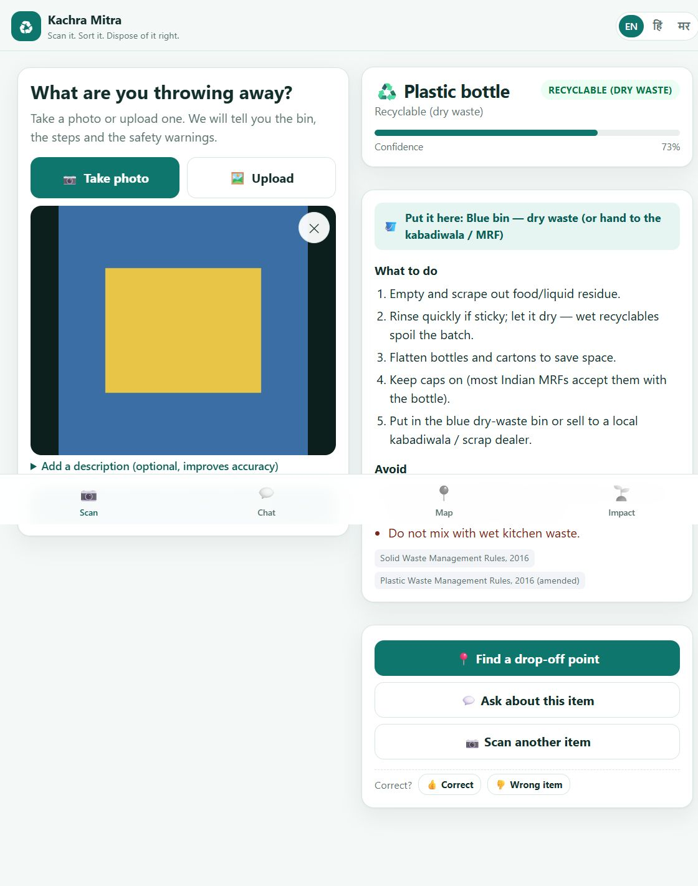
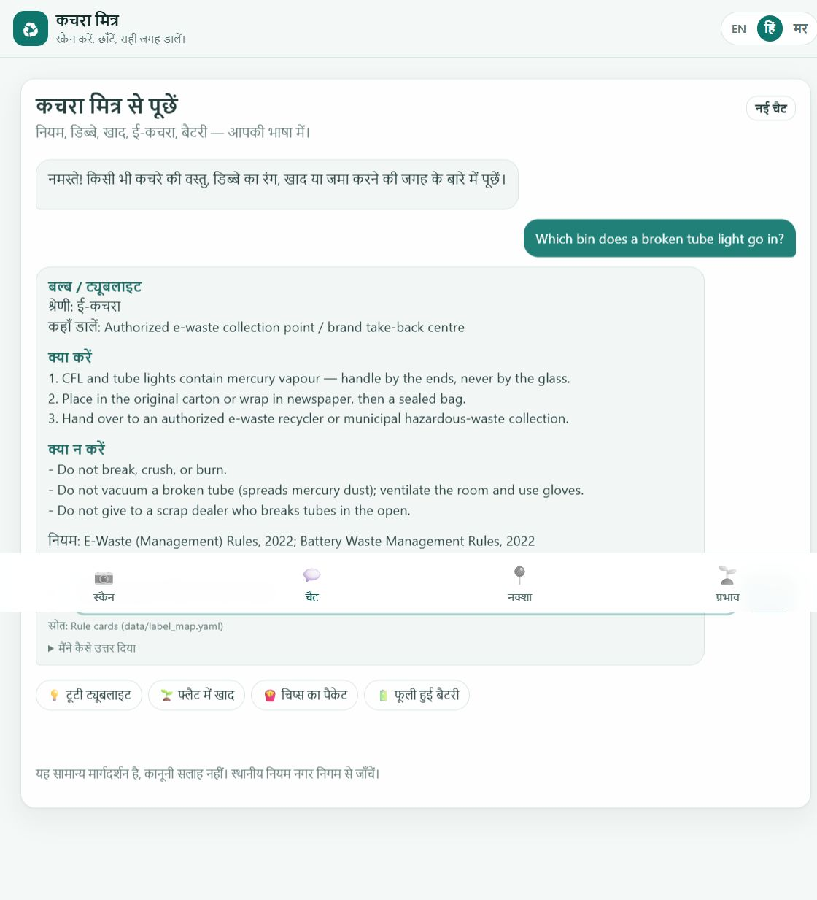
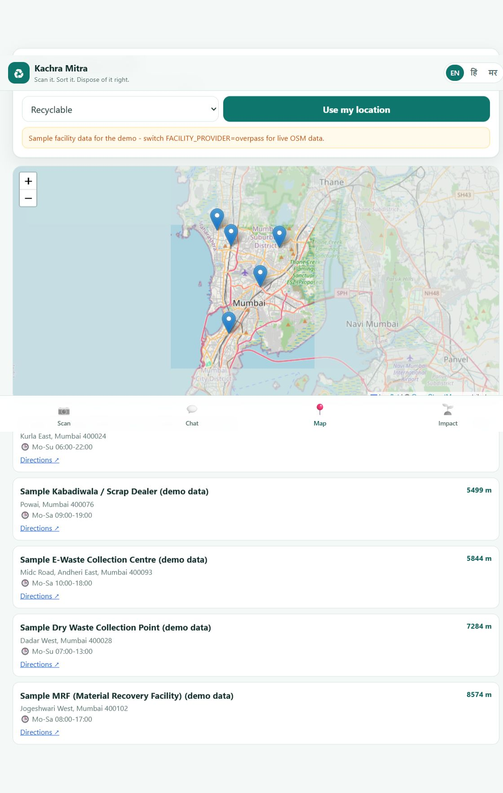

# AI-Based Smart Waste Identification & Disposal Assistant

**Kachra Mitra** — snap a photo of a waste item, get its name, category, confidence,
disposal steps and safety warnings; ask follow-up questions in English, Hindi or Marathi;
and find the nearest drop-off point on a map.

Built for the Indian context: **SWM Rules 2016**, **E-Waste Rules 2022**, **Plastic Waste
Rules**, **Battery Waste Rules 2022**, and **Bio-Medical Waste Rules 2016**.

Runs with **no API keys** and ships a **pretrained real-object model** — no training step
needed. If the model file is missing, the API honestly reports what is missing and the app
still answers from rule cards and sample map data.



| Chat in Hindi | Map with drop-off points |
|---|---|
|  |  |

## Status

| Step | Deliverable | Where |
|---|---|---|
| 1 | Architecture, stack comparison, API contract, NFRs | `docs/01-architecture.md` |
| 2 | Dataset plan, taxonomy, Indian data protocol | `docs/02-dataset-plan.md`, `data/label_map.yaml` |
| 3 | Model plan + train/eval/export/calibrate code | `docs/03-model-plan.md`, `ml/*.py`, `tools/build_manifest.py` |
| 4 | FastAPI backend | `docs/04-backend.md`, `backend/app/` |
| 5 | Tool-calling agent + BM25 RAG + guardrails | `docs/05-agent.md`, `backend/app/agent.py`, `backend/knowledge/` |
| 6 | Frontend (camera, result card, chat, history) | `docs/06-frontend.md`, `frontend/` |
| 7 | Maps: Overpass, cache, OSRM, fixtures | `docs/07-maps.md`, `backend/app/facilities.py` |
| 8 | Setup, requirements, env, troubleshooting | `docs/08-setup.md`, `backend/.env.example` |
| 9 | Tests, CI, Docker, deployment, 4-week plan | `docs/09-testing-deploy.md`, `.github/workflows/ci.yml` |
| 10 | Ethics, privacy, limitations, roadmap | `docs/10-ethics-limitations.md` |
| 11 | Vercel + Render + Cloudinary deployment | `docs/11-deploy.md`, `vercel.json`, `render.yaml` |

## The 60-second version

```
photo ──► optional vision model (Gemini / Groq)  ──► item + confidence
      └─► MobileNetV3-Large (ImageNet, ONNX)  ──► 1,000 objects → 32 waste items
      └─► MobileCLIP2-S0 (zero-shot, ONNX)    ──► "is this waste?" + all 32 items
              └─► fusion: one item + confidence
              └─► taxonomy card: bin, steps, don't, hazard, rule names
                  ├─► Leaflet map: nearest collection points (OSM / fixtures)
                  └─► chat agent: BM25 over the actual rules + 4 tools
                                  └─► answers in EN / HI / MR, with sources
```

Design decisions worth defending:

- **Item-level taxonomy (32 items, 6 categories)** instead of 6 generic classes — "battery"
  needs different advice from "charger".
- **Image classifier first, LLM second.** The LLM never invents the item or the hazard text.
- **Server-side hazard constants.** Battery/mercury/sharps warnings are appended by code and
  cannot be paraphrased away by a model.
- **Confidence gate + margin.** `p < 0.60` **or** `top1 − top2 < 0.15` asks "is it A or B?"
  instead of guessing.
- **Pretrained first, vision optional.** Two small ONNX models run offline on the CPU:
  MobileNetV3-Large names 1,000 real ImageNet objects (287 classes map onto our 32 items),
  and MobileCLIP2-S0 compares the photo against the *words* of all 32 items, which covers
  the ones ImageNet has no class for (battery, charger, bulb, circuit board, syringe,
  chips packet). Set `GEMINI_API_KEY` or `GROQ_API_KEY` to add cloud identification.
- **Two models, one answer.** ImageNet and CLIP are combined (`0.4 × ImageNet +
  0.6 × CLIP`), so a confident CLIP reading can correct an ImageNet mistake — ImageNet
  calls a soda can "pop bottle", CLIP knows it is a metal can.
- **"Not waste" is a class of its own.** CLIP also scores 20 negative prompts (dog, cat,
  person, car, room...). If those win, the app says it is not sure instead of guessing a bin.
- **Unmapped means "not sure".** A dog or a car never becomes a confident disposal answer.
- **No images stored.** Re-encoded uploads drop EXIF/GPS; SQLite stores item/category only.
- **Degrade, never crash.** No model → 503 with the fix command. No LLM → rule cards.
  No Overpass → cache, then fixtures, then the helpline text.

## Quickstart (10 minutes, Windows)

The repository already contains both pretrained models (ImageNet + CLIP), so **no training
step and no `requirements-ml.txt` install is needed** for a working scan — the API only
needs `backend/requirements.txt`.

```powershell
py -3.14 -m venv .venv
.\.venv\Scripts\Activate.ps1
pip install -r backend/requirements.txt

uvicorn backend.app.main:app --reload --port 8000
```

- App: **http://127.0.0.1:8000/app/**
- API docs: **http://127.0.0.1:8000/docs**
- Health: **http://127.0.0.1:8000/health** — expect `"classifier": {"ready": true}`

Optional open-vocabulary scanning (a cloud model that can name objects neither local model
knows):

```powershell
$env:GEMINI_API_KEY="your-free-key"   # aistudio.google.com
$env:VISION_PROVIDER="auto"
uvicorn backend.app.main:app --reload --port 8000
```

### Rebuild or retrain the model

```powershell
pip install -r requirements-ml.txt

# (a) rebuild the pretrained ImageNet model + mapping report
python tools/build_imagenet_model.py --out artifacts_pretrained

# (a2) rebuild the zero-shot CLIP head (text embeddings + fp16 visual encoder)
python tools/build_clip_model.py --check-images path/to/some/test/photos

# (b) or train the small demo model on synthetic rectangles (pipeline test only)
python tools/make_demo_data.py
python tools/build_manifest.py --raw-dir data/raw_demo --out data/demo/manifest.csv
python ml/train.py --manifest data/demo/manifest.csv --epochs 4 --freeze-epochs 1 `
  --batch 16 --out artifacts_demo --workers 0
python ml/evaluate.py --manifest data/demo/manifest.csv `
  --ckpt artifacts_demo/model_best.pt --split test
python ml/export_onnx.py --ckpt artifacts_demo/model_best.pt --out artifacts_demo
python ml/calibrate.py --ckpt artifacts_demo/model_best.pt `
  --manifest data/demo/manifest.csv --split val --out artifacts_demo
```

> The default `artifacts_pretrained/` model is pretrained on 1,000 real ImageNet objects
> and mapped to the waste taxonomy. The `artifacts_demo/` model is trained on coloured
> rectangles: it proves the training/export pipeline, not real-world accuracy.

### Linux / macOS

```bash
python3.12 -m venv .venv && source .venv/bin/activate
pip install -r backend/requirements.txt
uvicorn backend.app.main:app --port 8000
```

## Project structure

```
.
├─ data/label_map.yaml          single source of truth: categories, items, aliases, guidance
├─ artifacts_pretrained/        shipped ImageNet ONNX model + class→item labels + report
├─ tools/
│  ├─ taxonomy.py               loader + text matching used by ML and API
│  ├─ build_manifest.py         datasets -> manifest.csv (dedupe, split, report)
│  ├─ build_imagenet_model.py   export/merge MobileNetV3-Large + write labels
│  ├─ imagenet_map.py           1,000 ImageNet classes -> 32 waste items
│  └─ make_demo_data.py         synthetic images for a first run
├─ ml/
│  ├─ train.py                  MobileNetV3-Small transfer learning
│  ├─ evaluate.py               accuracy, macro-F1, ECE, coverage, per-class report
│  ├─ export_onnx.py            fp32 -> checker -> int8 -> parity -> labels.json
│  ├─ calibrate.py              temperature scaling (accuracy-preserving)
│  ├─ imagenet_predict.py       ImageNet aggregation + laptop/notebook disambiguation
│  └─ predict.py                fine-tuned OnnxClassifier (demo path)
├─ backend/
│  ├─ app/main.py               routes, lifespan, CORS, rate limit, /app mount
│  ├─ app/agent.py              bounded tool loop, memory, post-filter
│  ├─ app/tools.py              search_rules, get_item_guide, find_facilities, classify_image
│  ├─ app/knowledge.py          hand-rolled BM25 over backend/knowledge/*.md
│  ├─ app/vision.py             optional Gemini/Groq open-vocabulary identification
│  ├─ app/safety.py             hazard constants, PII redaction, refusals
│  ├─ app/facilities.py         Overpass + fixtures + SQLite cache + OSRM
│  ├─ app/classifier.py         model selection + taxonomy enrichment + text-hint fusion
│  ├─ app/imaging.py            validate / EXIF-strip / downscale (never saved)
│  ├─ app/db.py                 scans, feedback, facility cache
│  ├─ knowledge/*.md            6 rule documents used by RAG
│  ├─ fixtures/facilities.json  10 clearly-labelled sample points
│  └─ tests/                    41 tests, no keys required
├─ frontend/                    plain HTML/CSS/JS + Leaflet (no build step)
├─ docs/                        01..11, written for a student to defend
├─ Dockerfile, .github/workflows/ci.yml
└─ requirements-ml.txt, backend/requirements.txt
```

## API

| Method | Path | Purpose |
|---|---|---|
| GET | `/health` | capability flags (both models, CLIP head, LLM, map source) |
| GET | `/taxonomy` | 6 categories, 32 items, HI/MR names, colours |
| POST | `/classify` | `file`, `text_hint?`, `barcode?`, `lang`, `device_id?` |
| POST | `/chat` | `{message, lang, context, image_base64?}` → answer, warnings, facilities, sources, trace |
| POST | `/chat/reset` | drop server-side session memory |
| GET | `/facilities` | `lat, lng, category, radius_m, limit, refresh` |
| GET | `/facilities/{id}/directions` | OSRM steps + Google Maps link |
| GET | `/history` | scans, totals, category breakdown, eco points |
| POST | `/feedback` | correction for the active-learning queue |
| POST | `/admin/login` | `{password}` → signed token (off unless `ADMIN_PASSWORD` is set) |
| GET | `/admin/stats` | totals, today, uncertain rate, 14-day trend, category mix |
| GET | `/admin/scans` | paged scan log, filter by category or search text |
| GET | `/admin/feedback` | corrections joined with the prediction they disagreed with |
| GET | `/admin/export.csv` | everything above as a spreadsheet download |
| GET | `/admin/model` | exactly which models the server loaded, and why one is off |

```powershell
curl.exe -X POST http://127.0.0.1:8000/classify -F "file=@photo.jpg" -F "lang=hi"
curl.exe -X POST http://127.0.0.1:8000/chat -H "Content-Type: application/json" `
  -d "{\"message\":\"Where does a broken CFL go?\",\"lang\":\"en\"}"
curl.exe "http://127.0.0.1:8000/facilities?lat=19.11&lng=72.84&category=ewaste"
```

## Tests

```powershell
cd backend
..\.venv\Scripts\python.exe -m pytest tests -q      # 69 passed
```

The suite passes with **no API key and no model**. With the shipped pretrained model, the
full `/classify` path and the image-in-chat path also run. New tests cover ImageNet
probability aggregation, the laptop/notebook guard, vision JSON parsing, the
vision→taxonomy conversion, the admin API (tokens, throttling, CSV), and the raw bytes of
every frontend asset (a wrong codec once turned हिंदी into `हिंदी`).

```powershell
# CI runs the same suite on every push (no torch, ~1 min)
.github/workflows/ci.yml
```

## Configuration

Copy `backend/.env.example` to `backend/.env`. Defaults are demo-safe.

| Variable | Default | Notes |
|---|---|---|
| `ONNX_PATH` / `LABELS_PATH` | `artifacts_pretrained/...` | shipped pretrained model |
| `VISION_PROVIDER` | `auto` | `auto` / `gemini` / `groq` / `off` |
| `GEMINI_API_KEY` / `GROQ_API_KEY` | empty | enables open-vocabulary identification |
| `LLM_PROVIDER` | `fake` | `fake` / `groq` / `gemini` |
| `FACILITY_PROVIDER` | `fixture` | `fixture` / `overpass` |
| `CONFIDENCE_THRESHOLD` / `_MARGIN` | `0.60` / `0.15` | uncertain → follow-up question |
| `DB_PATH` | `backend/data/app.db` | SQLite |
| `RATE_LIMIT_PER_MIN` | `30` | per IP, in-memory |
| `ALLOW_ORIGINS` | `*` | tighten in production |
| `ADMIN_PASSWORD` | empty | admin panel passphrase; **empty = panel off** |

Full table and troubleshooting: `docs/08-setup.md`.

## Admin panel

Open **`/admin`** (on Vercel: `https://<project>.vercel.app/admin`, locally:
`http://127.0.0.1:8000/app/admin.html`) and sign in with `ADMIN_PASSWORD`.

It is read-only and stateless — no second database, no user table:

- **KPIs** — total scans, today vs yesterday, uncertain rate, corrections, average confidence
- **14-day trend** and **category mix**, plus the eight most-scanned items
- **Scans** — paged log with category filter and search; photos appear only if Cloudinary is on
- **Feedback** — every 👎 as predicted → corrected, which is the list to read before
  touching prompts or the taxonomy
- **Model & status** — the fastest way to answer "why is it guessing badly?"
- **Export CSV** — scan log plus corrections, ready for a spreadsheet or a re-train set

Security model, stated plainly: one shared passphrase from the environment, compared in
constant time, exchanged for an HMAC-signed token with an expiry. Failed logins are
throttled (8 per 10 minutes per IP). Changing the passphrase or restarting the service
invalidates every old token. The panel cannot write, delete, or run anything.

```powershell
$env:ADMIN_PASSWORD="a long random passphrase"   # then restart the API
start http://127.0.0.1:8000/app/admin.html
```

## Deploy

The repo ships ready-to-use config for the free stack: **Vercel** (frontend),
**Render** (FastAPI backend), **Cloudinary** (optional scan images).

```text
frontend/  -> Vercel, static, no build step
backend/   -> Render web service, ONNX Runtime
scans      -> Cloudinary, opt-in and sanitized
```

1. Push the repo to GitHub.
2. Render → New Blueprint → it reads `render.yaml`.
3. Edit `frontend/config.js` with the Render URL, then import the repo on Vercel
   (`vercel.json` serves `frontend/`).
4. Optional: set `CLOUDINARY_URL` + `IMAGE_STORAGE=true` on Render.

Step-by-step, CORS, free-tier caveats and troubleshooting:
**`docs/11-deploy.md`**.

Docker still works for a single-box deployment:

```powershell
docker build -t kachra-mitra .
docker run --rm -p 8000:8000 kachra-mitra
```

## Documentation

| File | Read it for |
|---|---|
| `docs/01-architecture.md` | diagrams, free vs production stack, API contract, NFRs |
| `docs/02-dataset-plan.md` | datasets, mapping, dedupe, splits, Indian collection protocol |
| `docs/03-model-plan.md` | model choice, training recipe, calibration, export, metrics |
| `docs/04-backend.md` | endpoints, design decisions, demo-mode matrix |
| `docs/05-agent.md` | tools, loop, BM25, guardrails, failure matrix |
| `docs/06-frontend.md` | UI, i18n, accessibility, manual test checklist |
| `docs/07-maps.md` | Overpass, tag mapping, cache, OSRM, India caveats |
| `docs/08-setup.md` | install, demo, real data, env vars, troubleshooting |
| `docs/09-testing-deploy.md` | test plan, CI, Docker, hosting, 4-week plan |
| `docs/10-ethics-limitations.md` | claims you can/cannot make, privacy, safety, open problems |
| `docs/11-deploy.md` | Vercel + Render + Cloudinary, free-tier caveats, troubleshooting |

## What it can recognise

| Tier | Runs on | Can answer | Needs |
|---|---|---|---|
| 1 | ImageNet ONNX (22 MB) | items covered by the 1,000 ImageNet classes (bottles, cans, laptops, clothes, food, furniture...) | nothing |
| 2 | MobileCLIP ONNX (23 MB) | any of the **32 items**, including the ones ImageNet lacks: battery, charger/cable, bulb, circuit board, syringe, chips packet, tetra-pak, aerosol; also rejects "not waste" photos | nothing |
| 3 | Gemini / Groq vision | arbitrary objects by name, in a sentence | a free API key |

Tiers 1 + 2 are fused into one answer and run fully offline on a 512 MB Render instance.
Tier 3 is optional and always falls back to tiers 1 + 2 when the key is missing.

## Honest limitations

- The local models **cannot name every object in the world**. ImageNet covers 1,000 classes
  and CLIP matches against our 32 descriptions, so a photo of a rare object ends in "not
  sure" (with a follow-up question) rather than an invented answer. That refusal is a
  feature: a wrong bin is worse than "please retake or type the item".
- CLIP is a *screening* model: it decides which of 32 disposal items a photo belongs to, it
  does not produce a free-text label. Use a vision key (tier 3) when you need the object's
  name ("this is a Havells 9 W CFL").
- The two models disagree sometimes. Fusion is weighted (0.4 ImageNet / 0.6 CLIP) and
  calibrated only by the small set of photos in `ml/clip_predict.py`'s smoke test — measure
  on your own photos before claiming accuracy.
- Datasets are studio-lit and under-represent Indian packaging; measure the `wild` split.
- Disposal **steps** are English; the UI and item names are translated.
- Facility data is a lead, not a guarantee. OSM coverage is thin outside metros.
- It is decision support, not legal/medical advice, and cannot make disposal "safe".
- Eco points are motivational, not measured offsets.

Read `docs/10` before writing any claim in a report or viva.

## Credits and licences

- Rules summarised from CPCB / MoEFCC public documents; verify current text with the source.
- OpenStreetMap data © OpenStreetMap contributors, **ODbL**; Leaflet is BSD-2-Clause.
- Dataset licences differ per source — check before redistributing images or weights.
- Code in this repository: use it for coursework and learning; add the dataset/model
  licence notices before any public or commercial release.
