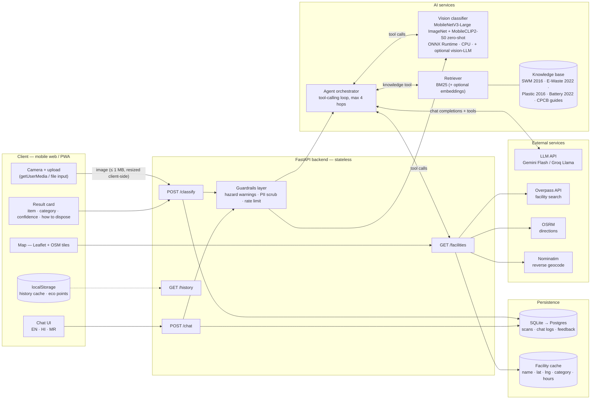
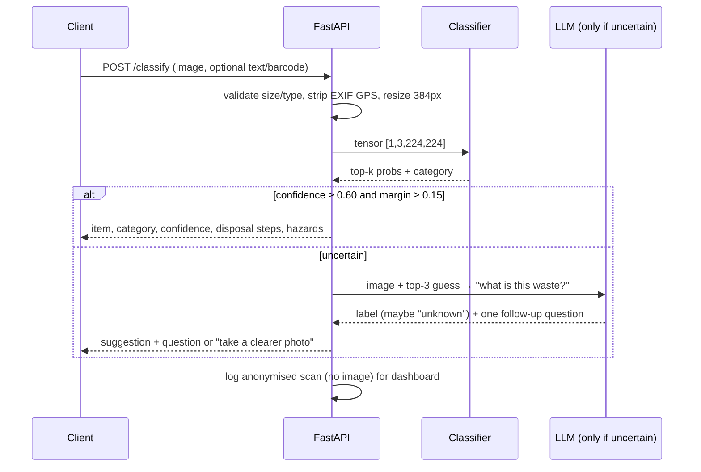
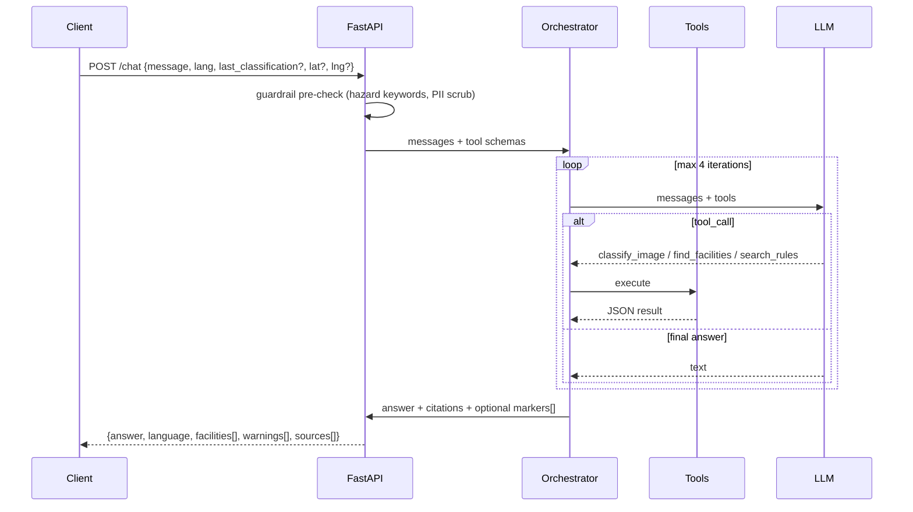

# 01 — System Architecture & Tech Stack

## 0. Assumptions

| # | Assumption | Why it matters |
|---|-----------|----------------|
| A1 | Single developer, 4-week timeline, student budget (₹0 infra) | Rules out GPU inference servers and self-hosted Kubernetes |
| A2 | Phone browser is the primary client (camera + GPS) | Camera capture must be web-based, not a native app |
| A3 | Users are in India, urban/semi-urban, mixed English/Hindi/Marathi literacy | UI needs icons + short text; chat must be multilingual |
| A4 | Network is 3G/4G, sometimes flaky | Classifier must degrade to on-device or a small upload payload |
| A5 | Accuracy target is "useful", not "perfect": macro-F1 ≥ 0.80 on 3 classes | Sets realistic dataset + model scope |
| A6 | Hazardous/e-waste misclassification is the highest-risk error | Drives confidence gating + guardrails, not just accuracy |
| A7 | Demo scale: ≤ 100 users/day, ≤ 1k scans/day | Free tiers are enough; no need for horizontal scaling |

Out of scope for v1: native mobile app, user accounts/passwords, payments, real-time
fleet tracking of collection trucks, offline maps.

---

## 1. High-level architecture



**Reading the diagram:** every blue box is something you write; every grey box is
something you rent. The only hard coupling is the `LLM` provider — it sits behind an
interface so you can swap Gemini ↔ Groq ↔ a local model.

---

## 2. Three request flows

### 2.1 Classify (with confidence gating)



### 2.2 Chat with tool calling



### 2.3 Facilities by category

`GET /facilities?lat=..&lng=..&category=ewaste&radius=5000`

1. Hit `facility_cache` (SQLite/Postgres) for the bounding box → return instantly if fresh (< 30 days).
2. On miss/empty → Overpass query filtered by OSM tags for that category (see §7 of the build plan).
3. Normalise, dedupe by (name, ~50 m), compute Haversine distance, sort, cache.
4. `GET /facilities/{id}/directions` → OSRM route + step list, or a deep link to Google Maps.

---

## 3. Component responsibilities

| Component | Owns | Explicitly does NOT do |
|---|---|---|
| Client | camera capture, client-side resize, map rendering, offline history | never calls the LLM directly (key exposure) |
| API gateway (`main.py`) | validation, CORS, rate limit, error shape | no business logic |
| Guardrails layer | hazard keyword scan, medical/PII refusal, output post-filter | not a substitute for model accuracy |
| Classifier service | image → {item, category, confidence} | no text, no maps |
| Agent orchestrator | tool loop, timeouts, fallback chain, language handling | no direct DB writes |
| Retriever | top-k rule passages + citations | does not generate text |
| Facility service | provider abstraction (Overpass ⇄ Google), cache | no routing logic beyond delegation |

---

## 4. Tech stack — option (a) free / student vs (b) production

| Layer | (a) Free / student-friendly | (b) Production-grade | Why the (a) choice |
|---|---|---|---|
| **Frontend** | Plain HTML + vanilla JS + Leaflet, served by FastAPI (or GitHub Pages) | React + TypeScript + Vite, Tailwind, PWA, Vercel/Cloudflare Pages | Zero build step = fewer moving parts for a student; same JS can move into React later |
| **Backend** | FastAPI + Uvicorn, Docker on **Hugging Face Spaces** (free CPU) or Render free | FastAPI on **Cloud Run / ECS Fargate**, Redis cache, RQ/Celery workers, API gateway | HF Spaces free tier: 2 vCPU / 16 GB, Docker, public URL, no card needed |
| **Model runtime** | ONNX Runtime CPU: pretrained MobileNetV3-Large (22 MB fp32 / 5.5 MB int8) **+ MobileCLIP2-S0 zero-shot (23 MB fp16)** + optional Gemini/Groq vision | ONNX Runtime / Triton on GPU, batch + autoscale, TFLite on device | Pretrained ImageNet gives real-object recognition with zero training, CLIP covers the 32 items ImageNet cannot name; a 224–256px image is ~30–90 ms CPU, so GPU is wasted money |
| **LLM** | **Google Gemini Flash free tier** or **Groq (Llama 3.3 70B) free tier** — both OpenAI-compatible-ish, both support tool calling | Paid GPT-4o-mini / Gemini Pro + provider fallback + prompt caching + LangGraph | Free tiers are generous; Gemini/Groq both handle Hindi & Marathi decently |
| **Multilingual** | Prompt-level ("answer in the user's language"); optional Bhashini/IndicTrans2 for hard cases | Dedicated translation layer + per-language eval set | Prompting is free and good enough; translation adds latency |
| **RAG store** | **BM25 (`rank_bm25`) in-process** over ~80 curated rule chunks | `pgvector` + chunked CPCB/MoEFCC corpus, nightly reindex, hybrid search | BM25 needs no embedding model → saves ~400 MB RAM and ~1 s latency on free CPU |
| **Database** | SQLite (file on the Space's persistent volume) | Postgres + PostGIS, read replica | Single writer is fine at 1k scans/day |
| **Maps** | **Leaflet + OSM tiles + Overpass API + OSRM demo server** (no API key, no card) | Google Places API (New) + Directions, results cached in PostGIS, budget alerts | Overpass is free and already contains Indian municipal/e-waste points; Google costs money per call |
| **Auth** | none — anonymous device UUID in `localStorage` | OTP/JWT, per-user quotas | No personal data = smaller privacy surface |
| **Observability** | structured JSON logs + `/health` | OpenTelemetry, Sentry, Grafana, prompt/response evals (Ragas, promptfoo) | You need to debug, not to run SLOs |
| **CI/CD** | GitHub Actions: lint + pytest + deploy on push | same + Terraform + staging env + canary | Free minutes are enough |
| **Cost** | **₹0** | ~₹4k–20k / month at low traffic (LLM tokens dominate) | |

### Recommendation

**Build (a) now, but code against (b)'s interfaces.** Concretely:

- `LLMProvider` protocol → `GeminiProvider`, `GroqProvider`, `FakeProvider` (tests).
- `FacilityProvider` protocol → `OverpassProvider`, `GooglePlacesProvider`, `FixtureProvider` (tests/offline demo).
- Model always loaded through ONNX Runtime → the same file runs on HF Spaces, Cloud Run, and (converted) on-device.
- Config via `.env` only; no hardcoded keys or URLs.

This gives a working free demo today and a one-file change to go production.

---

## 5. API contract (frozen now so frontend/backend can be built in parallel)

### `POST /classify` — multipart or JSON
```jsonc
// request (multipart/form-data)
{ "file": "<jpeg>", "text_hint": "old phone charger", "barcode": "8901234567890", "lang": "hi" }

// response 200
{
  "item": "charger_cable",
  "item_display": "Charger / cable",
  "category": "ewaste",
  "category_display": "E-waste",
  "confidence": 0.91,
  "top_k": [{"item": "charger_cable", "p": 0.91}, {"item": "phone", "p": 0.05}, {"item": "metal_scrap", "p": 0.02}],
  "uncertain": false,
  "hazards": [],
  "disposal": {
    "bin": "Authorized e-waste collection point (never dry-waste bin)",
    "steps": ["Wipe your data if it stores memory", "Coil and tie the cable", "Hand over at a brand take-back counter or authorized recycler"],
    "do_not": ["Do not cut and burn copper for scrap", "Do not put in the blue dry-waste bin"],
    "rule_refs": ["E-Waste (Management) Rules, 2022"]
  },
  "facility_category": "ewaste",
  "follow_up": null,
  "scan_id": "scn_01HV..."
}
```
When `uncertain: true`, `follow_up` is a single question, e.g.
`"Is this a charger/adapter or a battery?"` or `"Could you retake the photo in better light?"`.

### `POST /chat`
```jsonc
// request
{ "session_id": "ses_...", "message": "ट्यूबलाइट फूट गई है, क्या करूँ?", "lang": "hi",
  "context": {"category": "ewaste", "item": "bulb_tube_light", "lat": 19.07, "lng": 72.87} }
// response
{ "answer": "...", "language": "hi", "warnings": [{"level": "danger", "text": "Mercury — ventilate, do not vacuum"}],
  "facilities": [{"id": "osm:node:123", "name": "...", "distance_m": 1840}],
  "sources": [{"title": "E-Waste (Management) Rules, 2022", "url": "..."}],
  "tool_trace": ["search_rules", "find_facilities"] }
```

### `GET /facilities`
Query: `lat`, `lng`, `category` (ewaste | recyclable | general | organic | hazardous | biomedical),
`radius_m` (default 5000, max 25000), `limit` (default 20), `refresh=false`.
Returns `{ "results": [...], "source": "cache|overpass|google", "stale": false }`.

### `GET /history?device_id=...` and `POST /feedback`
History: last 50 scans (category, item, timestamp, eco_points delta) — **no images stored**.
Feedback: `{scan_id, correct_item?, correct_category?, comment?}` → feeds the retraining queue.

---

## 6. Non-functional targets

| Metric | Target | How |
|---|---|---|
| Classify p95 (server, CPU) | ≤ 1.5 s | 224px + int8 ONNX + warm model at startup |
| Image upload | ≤ 400 KB | client-side canvas resize to 768px, JPEG q=0.8 |
| Chat first token | ≤ 2.5 s | stream from LLM; 3 tool hops max |
| Facility search p95 | ≤ 3 s cold, ≤ 80 ms warm | cache + 25 s Overpass timeout |
| Availability | best-effort on free tier | graceful "try again" UI, never a blank screen |
| Accessibility | works at 320 px width, ≥ 16 px text, icon + label pairing | low-literacy support |
| Privacy | no images persisted, EXIF GPS stripped, no accounts | see step 10 |

---

## 7. Failure modes → behaviour

| Failure | User sees | System does |
|---|---|---|
| Model low confidence | "Is it a charger or a battery?" + retake button | vision-LLM second opinion, then abstain |
| LLM timeout / 429 | classifies-only answer + "AI helper is busy" | template answer from rule card, retry with backup provider |
| Overpass 429/timeout | last cached facilities or "no mapped facility nearby" + helpline | exponential backoff, 30-day cache |
| GPS denied | manual city/pincode picker | Nominatim geocode on submit |
| Offline | cached last 20 scans + cached rules | service worker |
| Hazardous item detected | red banner before any other text | warnings injected server-side, cannot be suppressed by the LLM |

---

## 8. Risks

| Risk | Impact | Mitigation |
|---|---|---|
| Waste classifiers overfit TrashNet's clean studio backgrounds | Useless on real photos | Always keep a "wild" test set (TACO + own phone photos); report both numbers |
| Free LLM tier limits / deprecation | Demo breaks before review | Two providers behind one interface + template fallback |
| Overpass coverage in smaller Indian cities is thin | Empty map → looks broken | Seed a curated facility table for your city; show helpline + "add a facility" form |
| Rules change (EPR, plastic bans) | Wrong legal guidance | Date-stamp every rule chunk; cite source URL; add "verify locally" line |
| Mercury/battery safety mishandled | Real harm + liability | Hard-coded hazard templates that the LLM cannot override; visible disclaimer |
| EXIF GPS leak in uploaded photos | Privacy harm | Strip EXIF server-side before any processing; never store originals |

---

## 9. Why not these (rejected options)

- **Serverless-only (Lambda) for the classifier** — cold starts with torch/onnx + 1 s budget = bad UX. ONNX + a small always-on container is simpler.
- **Vision-LLM as the only classifier** — per-scan cost + latency + no confidence calibration. Use it as the *fallback*, not the primary.
- **YOLO as v1** — you need one label per photo, not boxes; the detection model costs 5–10× the labelling effort for this use case (see step 3 for the exception).
- **pgvector from day 1** — 80 documents do not need embeddings; BM25 wins on cost, RAM, and latency.
